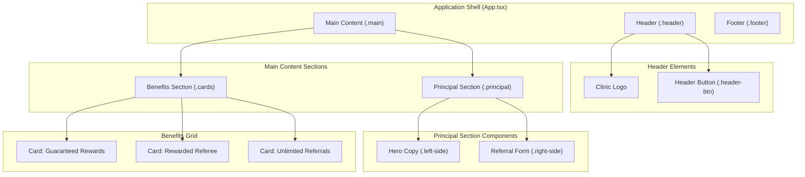

# Joyce Martins Odontologia - Referral Landing Page

A responsive referral and loyalty landing page for Joyce Martins Odontologia, built with React, TypeScript, and fluid CSS design principles.

---

## Technology Stack

- Runtime and Framework: React 19.3
- Language: TypeScript 6.0
- Build Tool: Vite 8.3
- Styling Architecture: Plain CSS, CSS Modules, and fluid `clamp()` utilities
- Icons: React Icons 5.7
- Linter: ESLint 10

---

## Architecture and Component Hierarchy

The application follows a component-driven structure with dedicated modular styles and fluid layout scaling.



---

## Getting Started

### Prerequisites

- Node.js (version 20 or higher recommended)
- pnpm (version 9 or higher)

### Installation

1. Clone the repository to your local environment.
1. Install project dependencies:

```bash
pnpm install
```

### Development Server

Start the local development server with Hot Module Replacement (HMR):

```bash
pnpm dev
```

The application runs locally at `http://localhost:5173`.

### Production Build

Compile TypeScript and build the optimized production assets:

```bash
pnpm build
```

Compiled bundles are placed in the `./dist` directory.

### Preview Build

Locally preview the generated production build:

```bash
pnpm preview
```

---

## Key Scripts

| Command | Description |
| :--- | :--- |
| `pnpm dev` | Starts the Vite development server with HMR. |
| `pnpm build` | Compiles TypeScript declarations and builds production bundles. |
| `pnpm lint` | Runs ESLint to check for code quality and syntax issues. |
| `pnpm preview` | Serves the production bundle locally for validation. |

---

## Fluid Responsiveness and Layout Strategy

The application relies on continuous fluid scaling using CSS `clamp()` functions to minimize jarring layout shifts between breakpoints:

- **Typography**: Fluid font sizes scale dynamically between mobile viewports (320px) and large displays (1440px) using calibrated `rem` and `vw` combinations.
- **Spacing**: Padding, margins, and grid gaps adjust smoothly, reducing reliance on dense media queries.
- **Touch Targets**: Interactive controls maintain minimum touch heights compliant with WCAG accessibility standards.
- **Structural Breakpoints**:
  - `64rem` (1024px): Layout padding and vertical flow adjustments for medium laptops and tablets in landscape mode.
  - `48rem` (768px): Collapses two-column forms and hero content into single-column vertical stacks.
  - `30rem` (480px): Streamlines internal card padding and switches footer layout to vertical orientation.

---

## Project Structure

```text
landingpage-odonto/
|-- public/
|   |-- favicon.svg
|   `-- icons.svg
|-- src/
|   |-- assets/
|   |   `-- img/
|   |       `-- logo-joyce-martins.png
|   |-- components/
|   |   |-- Button/
|   |   |   |-- Button.tsx
|   |   |   `-- Button.module.css
|   |   `-- Card/
|   |       |-- Card.tsx
|   |       `-- Card.module.css
|   |-- App.css
|   |-- App.tsx
|   |-- index.css
|   `-- main.tsx
|-- eslint.config.js
|-- index.html
|-- package.json
|-- tsconfig.json
`-- vite.config.ts
```
